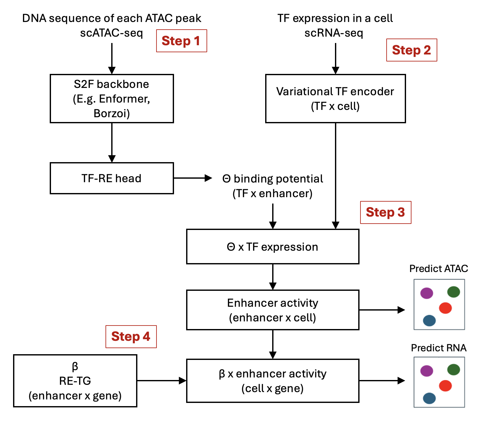

::: {.callout-note appearance="simple"}
## TL;DR
DeepSCENIC is a new preprint from Stein Aerts' lab (VIB / KU Leuven) that combines two worlds: deep learning models that read DNA, and single-cell data that tells you which transcription factors are actually present in each cell. The result is an interpretable gene regulatory network you can *perturb in silico*, either by knocking down a transcription factor or by mutating a single base of an enhancer. It's promising, but it's still a preprint, and its numbers are solid rather than spectacular.

[Read]{.verdict .verdict-read}   **Paper:** [Partel et al., bioRxiv 2026](https://www.biorxiv.org/content/10.64898/2026.09.18.752607)   **Code:** [aertslab/deepSCENIC](https://github.com/aertslab/deepSCENIC) · [analyses](https://github.com/aertslab/deepSCENIC_analyses)
:::

## Who this post is for

This post assumes you've **never used DeepSCENIC** and may come from one of three backgrounds:

- **Biologists:** you have a strong grasp of the biology but find computational papers hard going, or you just want a general overview of the computational side.
- **Bioinformaticians:** you want a TL;DR of the paper. Maybe you have a journal club coming up and no time to prepare, or you just want a general understanding of the tool.
- **CS / ML students:** you understand how deep learning works and are curious how it maps onto the biology.

## A 3-minute primer on gene regulation

Every cell in your body carries (nearly) the same DNA, yet a neuron and a liver cell look and behave completely differently. The difference comes from **which genes are switched on**, and that switching is controlled by a network of interacting parts:

| Component | What it is | Analogy |
|---|---|---|
| **Transcription factor (TF)** | A protein that binds DNA and turns genes up or down | A key |
| **Motif** | The short DNA pattern a TF recognizes (e.g., `GATA`) | The shape of a keyhole |
| **Enhancer / regulatory element (RE)** | A stretch of DNA, often far from a gene, where TFs bind | A lock with many keyholes |
| **Target gene (TG)** | The gene whose expression the enhancer controls | The door that opens |
| **Gene regulatory network (GRN)** | The full map of TF → enhancer → gene connections | The building's master-key system |

Two kinds of regulation matter here:

- ***Cis*-regulation:** the DNA sequence itself, i.e., which motifs an enhancer contains and in what arrangement.
- ***Trans*-regulation:** the cellular environment, i.e., which TF proteins are actually present and how much.

A gene is only switched on when **both** line up: the right keyholes in the DNA *and* the right keys in the cell.

### How we measure this in single cells

Modern **single-cell multiome** experiments measure two things in the *same* cell:

- **scRNA-seq:** how much each gene (including each TF) is expressed.
- **scATAC-seq:** which regions of DNA are "open" (accessible), a proxy for active enhancers. Each open region is called a **peak**.

## The problem: two halves of one puzzle

Before DeepSCENIC, the field had two families of tools that each solved half the problem.

### Half 1: Sequence-to-function (S2F) models read DNA but ignore the cell

S2F models are deep networks that take raw DNA sequence and predict molecular readouts such as chromatin accessibility or gene expression. Well-known examples include:

- **Enformer** and **Borzoi:** transformer-based models with very large input windows (hundreds of kilobases).
- **CREsted, BPNet, ChromBPNet:** convolutional models focused on short regions (around 2 kb).
- **HyenaDNA:** a "DNA language model" trained self-supervised on the genome.

They're excellent at learning motif grammar. Their blind spot is that they only see *cis* sequence and **don't take the TF environment of the cell into account**. They can find a binding site with high confidence but have no idea *which* TF protein binds it.

### Half 2: GRN inference tools know the cell but read DNA crudely

Tools like **SCENIC+**, **Pando** and **CellOracle** build TF → enhancer → gene networks from single-cell multiome data. To place TFs on enhancers they mostly rely on **position weight matrices (PWMs)** plus correlation and distance heuristics.

A PWM is a simple scoring table describing which bases a TF prefers at each position of its motif. PWMs are built by individual labs from wet-lab experiments (e.g., ChIP-seq, SELEX) or computational motif discovery, and consortia compile, validate and standardize thousands of them into open-access databases such as JASPAR and HOCOMOCO.

PWMs have real drawbacks:

- They score each position independently and **miss the richer grammar** of enhancers: spacing, affinity and combinations of motifs.
- They only cover **what has been curated**. Motifs for poorly studied TFs may be missing or low quality, and the collections reflect which TFs and experiments people chose to study.
- Short motifs match all over the genome, producing **many false positives**.

### DeepSCENIC's pitch

> Use an S2F model to read the DNA of each enhancer (the ATAC peaks), combine it with how much of each TF is present in each cell (from the RNA), and use that to predict both accessibility and gene expression. The trained model is itself a TF → enhancer → gene network.

## How DeepSCENIC works

{fig-alt="DeepSCENIC architecture: DNA sequences of ATAC peaks pass through an S2F backbone and TF–RE head to give binding potentials θ (Step 1); TF expression passes through a variational TF encoder (Step 2); θ and TF availability combine into enhancer activity, which predicts ATAC (Step 3); β links enhancers to genes to predict RNA (Step 4)."}

### Step 1: Read the DNA (binding potential, θ)

Each ATAC peak's DNA sequence is fed through a pretrained S2F backbone, which outputs an **embedding**: a long vector of numbers describing that sequence. On their own, the numbers in this vector have no biological names.

A small network on top, the **TF–RE head**, turns each enhancer's embedding into one score per TF: the **binding potential**, i.e., "how well could TF *t* bind enhancer *r*, based on sequence alone?" Doing this for every enhancer gives the θ matrix.

The TF–RE head is new, so it starts untrained and its first θ values are meaningless. During training, the head (and the backbone, through fine-tuning) are adjusted until θ reflects real TF–enhancer binding. No motif database is ever provided; the model has to work out each TF's preferences from the data.

**Result:** θ, shape **TF × enhancer**

**Why the S2F model matters:** these models have been trained on large genomic datasets to predict molecular readouts from sequence, so they already "know" a lot of regulatory grammar. DeepSCENIC reuses that knowledge (transfer learning). Because the binding scores are learned from sequence rather than looked up in a curated list, they aren't limited to known motifs and can capture context such as motif spacing and combinations.

### Step 2: Check who's in the room (TF availability)

Next, the model brings in the RNA side of the multiome data: how much of each TF is expressed in each cell. Each TF's expression value is passed through a small **variational encoder** (the "VAE" part), which turns it into a latent **availability** value.

Unlike a typical VAE, this one does **not** compress the data. It works on each TF separately, mapping one number in to one number out, so every latent value still belongs to a named TF. Its job is to:

- **convert mRNA levels into an effective "availability"** with a learned, monotonic curve: more mRNA never means less availability, but it can saturate;
- **handle noise** in single-cell data by treating each value as a distribution rather than an exact number;
- **keep values on a stable scale** (via the KL penalty), which keeps θ comparable across TFs.

**Starting shape:** cell × TF (expression)
**Result:** cell × TF (latent availability), the same shape

### Step 3: Add up the TFs (enhancer activity)

Each TF's activity on an enhancer is its **binding potential × its availability in that cell**. Both have to be high: a perfect binding site does nothing if the TF is absent, and an abundant TF does nothing without a site to bind.

An enhancer's overall activity in a cell is the **sum of all TF activities on it**. In matrix terms:

**availability (cell × TF) · θ (TF × enhancer) = enhancer activity (cell × enhancer)**

Enhancer activity has the same shape as the ATAC data, so each enhancer's activity is passed through a small decoder to predict that peak's chromatin accessibility.

<!-- FORMULA PLACEHOLDER: TF activity and enhancer activity -->

### Step 4: Connect enhancers to genes (β)

To predict gene expression, the model uses a second matrix, **β**, which maps enhancers to genes. Each entry is a learned weight: how strongly enhancer *r* controls gene *g*. Only enhancers within **±1 Mb** of a gene's transcription start site are allowed a weight; all other pairs are fixed at zero.

β starts with arbitrary values. During training, its weights are adjusted so that the predicted gene expression matches the real scRNA-seq data. A sparsity penalty pushes most weights to zero, so each gene ends up linked to a handful of enhancers.

**β shape:** enhancer × gene

Finally, enhancer activity is combined with β to predict gene expression:

**enhancer activity (cell × enhancer) · β (enhancer × gene) = regulatory input (cell × gene)**

Each gene's regulatory input is then passed through a shared decoder to give its predicted expression (**cell × gene**).

<!-- FORMULA PLACEHOLDER: Gene expression from enhancers -->

::: {.callout-tip appearance="simple"}
## 🧬 Bio note
±1 Mb is a generous window. Most enhancer–gene contacts are closer, so the model adds a distance penalty that makes distal links "cost" more (see below).
:::

### Shapes at a glance

| Stage | Shape |
|---|---|
| TF expression (input) | cell × TF |
| Latent TF availability | cell × TF |
| θ (binding potential) | TF × enhancer |
| Enhancer activity → predicts ATAC | cell × enhancer |
| β (enhancer → gene weights) | enhancer × gene |
| Gene expression (output) | cell × gene |

### Why this design matters

The two learned matrices, **θ (TF → enhancer)** and **β (enhancer → gene)**, *are* the gene regulatory network. You don't need a separate post-hoc explanation method to extract it: the model's internal wiring is directly readable as biology.

Multiplying them gives TF → gene links directly: **θ (TF × enhancer) · β (enhancer × gene) = TF × gene**. Scaling each TF's row by its availability in a given cell type gives that cell type's TF → gene scores.

## Training: what the model learns from

### Inputs and outputs

- **Inputs:** one-hot encoded DNA sequences of ATAC peaks, and each cell's TF expression vector.
- **Training targets:** reconstruct each cell's **gene expression** (scRNA) and **chromatin accessibility** (scATAC).

### The loss function

The objective is a weighted sum of several terms:

| Term | What it does |
|---|---|
| RNA reconstruction (mean absolute error) | Predict gene expression well |
| ATAC reconstruction (cosine similarity) | Predict accessibility well |
| KL divergence | Keeps the TF latent well-behaved (standard VAE regularizer) |
| L1 penalty on θ | Makes TF–enhancer links sparse (few TFs per enhancer) |
| Distance-weighted L1 on β | Makes enhancer–gene links sparse, penalizing far links more |

### Training stages

1. **Joint fine-tuning:** the S2F backbone, TF–RE head and GRN module train together. To stay tractable with hundreds of thousands of peaks, only a random subset of peaks goes through the backbone at each step; the rest reuse their cached θ values from earlier steps.
2. **Recalibrate β:** the backbone is frozen, all θ values are recomputed cleanly, and the enhancer–gene weights β are re-optimized against them.
3. **Test on unseen chromosomes:** peaks from held-out chromosomes are scored with the frozen backbone to check that the sequence model generalizes to new loci.

## What you get out of it

After training, DeepSCENIC gives you:

1. **A single-cell-resolution GRN:** TF → enhancer → gene links with strengths.
2. **Cell-type master regulators:** TFs ranked by activity on enhancers that are specifically active in each cell type.
3. **Nucleotide-level explanations:** which bases in an enhancer drive each TF's binding.
4. **An in silico perturbation simulator**, in two flavors:

### *Trans* perturbation: knock down a TF

Set a TF's expression to zero (or raise it for overexpression), push it through the network, and read out the new predicted expression of every gene. Because TFs are genes too, the predicted TF levels are fed back in and the process is **repeated for a few iterations**, so that indirect, downstream effects ripple through. In the melanoma analysis they used 5 iterations.

### *Cis* perturbation: mutate the DNA

Change bases in an enhancer, recompute θ via the backbone, keep the cell's TF levels fixed, and see how predicted enhancer activity and gene expression change.

## Strengths

- **Interpretable by design.** θ and β are biologically meaningful matrices, not hidden weights.
- **Learns motifs without a motif database.** No PWM prior is needed.
- **Unified cis + trans simulation.** One model handles TF knockdowns and DNA variants.
- **The simulator *is* the network.** SCENIC+ and CellOracle bolt a separate statistical model onto a fixed network; DeepSCENIC perturbs the same parameters that make its predictions.
- **Sidesteps a known weakness of long-range models.** Large S2F models tend to underweight distal enhancers, so DeepSCENIC models local sequence per peak and links enhancers to genes with explicit weights.
- **Backbone-agnostic.** Swap in Enformer, Borzoi, HyenaDNA or CREsted.
- **Open source**, with a separate repository to reproduce the paper's figures.

## Limitations and things to watch

**Acknowledged by the authors:**

- It struggles to separate TFs that bind similar sites and are co-expressed, such as HNF1A and HNF4A in liver cells.
- Its enhancer–gene predictions still trail models trained directly on CRISPRi data.
- Only TF perturbations are supported; signaling pathways and drugs aren't modeled yet.
